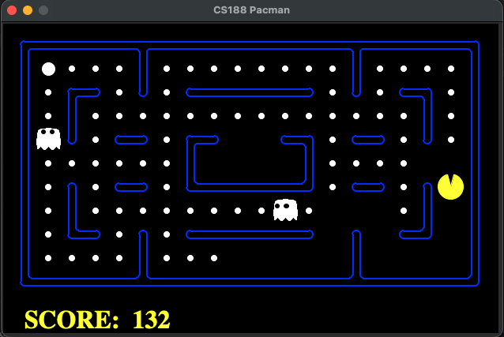
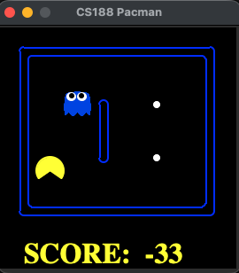
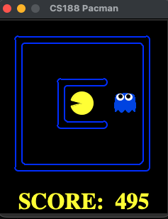

# Introducción y objetivo

En este experimento se estudió el comportamiento de un agente de Q-learning en Pacman al modificar sus parámetros de aprendizaje y utilizar diferentes tableros. Se comparó su desempeño en un entorno donde debe recoger comida y evitar a los fantasmas.

El objetivo fue observar cómo estos cambios se reflejan en las recompensas durante el entrenamiento, el puntaje promedio y el número de victorias durante la evaluación.

# Metodología

Se utilizó `PacmanQAgent`, un agente de Q-learning, con 2000 episodios de entrenamiento y 10 de evaluación por configuración. Cada episodio corresponde a un juego completo de Pacman. En cada ejecución, el agente se entrenó desde cero y se utilizó una semilla aleatoria fija mediante la opción `-f`, que establece la semilla `cs188` en esta implementación. No se reutilizaron los valores aprendidos entre configuraciones.

El caso 01 corresponde a la configuración base; los casos 02-07 mantienen `smallGrid` y modifican un parámetro respecto a ella. Los casos 08-11 utilizan `mediumGrid` y `mediumClassic`, con los parámetros base y con alpha alto. Para comparar tableros con los mismos parámetros se utilizan los casos 01, 08 y 10. El efecto de alpha dentro de cada tablero se compara mediante los pares 01/05, 08/09 y 10/11. Se mantuvo el mismo número de episodios en todos los casos. No se evaluaron todas las combinaciones de parámetros en todos los tableros.

## Agente, entorno y aprendizaje

El agente es Pacman, que se desplaza por el tablero para recoger comida y evitar a los fantasmas. El entorno está formado por los pasillos, las paredes, la comida y los fantasmas. Las capturas de evaluación permiten observar diferencias en la distribución de estos elementos entre los tres tableros.

El estado corresponde a la situación del juego en un momento determinado, por ejemplo, dónde se encuentran Pacman y los fantasmas y qué comida queda por recoger. Las acciones permiten a Pacman desplazarse por los caminos disponibles. El puntaje muestra las consecuencias acumuladas de lo que ocurre durante el juego, mientras que las recompensas orientan el aprendizaje del agente.

Durante el entrenamiento, el agente aprende a partir de su interacción con el entorno. Después se evalúa su comportamiento utilizando lo aprendido. En este experimento, ese desempeño se comparó mediante las recompensas de entrenamiento, los puntajes y las victorias de evaluación. Las imágenes ilustran los tableros; por sí solas no muestran el proceso de aprendizaje.

Al finalizar los 2000 episodios de entrenamiento, la implementación establece epsilon y alpha en cero. Los diez juegos de evaluación se realizan sin la exploración controlada por epsilon y sin nuevas actualizaciones del aprendizaje.

## Parámetros y configuraciones

Se variaron tres parámetros durante el entrenamiento:

- **Epsilon:** probabilidad de seleccionar una acción exploratoria al azar. Controla el equilibrio entre explorar acciones y aprovechar los valores aprendidos.
- **Alpha:** tasa de aprendizaje. Controla cuánto influye una experiencia nueva en lo aprendido previamente; un valor alto da más peso a la experiencia reciente.
- **Gamma:** factor de descuento. Determina cuánto pesan las recompensas futuras respecto a las inmediatas; un valor cercano a uno mantiene una mayor influencia de recompensas más lejanas.

La siguiente tabla identifica las once configuraciones evaluadas y los valores utilizados durante el entrenamiento.

| Caso | Tablero       | Configuración | Epsilon | Alpha | Gamma |
|------|---------------|---------------|--------:|------:|------:|
| 01   | smallGrid     | Base          |    0.10 |  0.30 |  0.70 |
| 02   | smallGrid     | Epsilon bajo  |    0.01 |  0.30 |  0.70 |
| 03   | smallGrid     | Epsilon alto  |    0.50 |  0.30 |  0.70 |
| 04   | smallGrid     | Alpha bajo    |    0.10 |  0.05 |  0.70 |
| 05   | smallGrid     | Alpha alto    |    0.10 |  0.80 |  0.70 |
| 06   | smallGrid     | Gamma bajo    |    0.10 |  0.30 |  0.10 |
| 07   | smallGrid     | Gamma alto    |    0.10 |  0.30 |  0.95 |
| 08   | mediumGrid    | Base          |    0.10 |  0.30 |  0.70 |
| 09   | mediumGrid    | Alpha alto    |    0.10 |  0.80 |  0.70 |
| 10   | mediumClassic | Base          |    0.10 |  0.30 |  0.70 |
| 11   | mediumClassic | Alpha alto    |    0.10 |  0.80 |  0.70 |

## Métricas

Se registraron las recompensas promedio de los episodios 1-100 y 1901-2000 de entrenamiento, el puntaje promedio de los diez juegos de evaluación y la cantidad de victorias y derrotas. Las recompensas de entrenamiento incluyen exploración y aprendizaje, mientras que la evaluación utiliza la política obtenida al terminar el entrenamiento.

La comparación del efecto de los parámetros se realiza dentro de un mismo tablero. Al comparar tableros, se consideran también las victorias, ya que la cantidad de comida y los recorridos pueden producir diferencias de puntaje entre entornos. Cada configuración se ejecutó una vez con semilla fija; no se estimó la variabilidad entre semillas.



# Resultados

La tabla presenta los resultados de las once configuraciones. «Primeras 100» y «Últimas 100» corresponden al entrenamiento, mientras que el promedio de evaluación y las victorias y derrotas corresponden a los diez juegos posteriores.

| Caso | Primeras 100 | Últimas 100 | Promedio de evaluación | Victorias | Derrotas |
|------------|-----------:|-----------:|-----------:|-----------:|-----------:|
| 01   |      -509.49 |      -15.11 |                  500.5 |        10 |        0 |
| 02   |      -510.71 |      449.04 |                  500.2 |        10 |        0 |
| 03   |      -509.46 |     -490.58 |                 -506.4 |         0 |       10 |
| 04   |      -510.23 |     -158.84 |                  494.2 |        10 |        0 |
| 05   |      -509.51 |       23.42 |                  501.6 |        10 |        0 |
| 06   |      -510.27 |      -68.34 |                  195.1 |         7 |        3 |
| 07   |      -499.85 |      125.37 |                  499.4 |        10 |        0 |
| 08   |      -470.67 |     -447.06 |                 -503.7 |         0 |       10 |
| 09   |      -491.25 |     -468.71 |                 -414.7 |         1 |        9 |
| 10   |      -434.93 |     -404.74 |                 -401.4 |         0 |       10 |
| 11   |      -434.93 |     -389.67 |                 -384.7 |         0 |       10 |

## Tableros utilizados

Las siguientes capturas se tomaron durante la evaluación de los casos 11, 09 y 07 y se incluyen para ilustrar la distribución de los tres tableros utilizados. En esta fase, epsilon y alpha estaban en cero. Los puntajes visibles corresponden al instante de cada captura y no representan el promedio de evaluación de cada caso. Las imágenes tienen un propósito ilustrativo y no se utilizan para demostrar diferencias de desempeño entre configuraciones.

### Captura del caso 11: mediumClassic con alpha alto

{#fig-caso-11 width="70%" fig-align="center"}

### Captura del caso 09: mediumGrid con alpha alto

{#fig-caso-09 width="38%" fig-align="center"}

### Captura del caso 07: smallGrid con gamma alto

{#fig-caso-07 width="38%" fig-align="center"}

# Análisis y discusión

## Efecto de epsilon

En `smallGrid`, el caso base, con epsilon de 0.10, y el caso con epsilon de 0.01 ganaron los diez juegos de evaluación. Sus puntajes promedio fueron 500.5 y 500.2, respectivamente. Esta diferencia es pequeña y no permite señalar una ventaja clara en la evaluación.

Durante el entrenamiento sí apareció una diferencia mayor: la recompensa promedio de los últimos 100 episodios fue 449.04 con epsilon bajo y -15.11 en el caso base. Una posible explicación es que, al explorar con menor frecuencia, el agente pudo aprovechar más las acciones que ya había aprendido. Sin embargo, este resultado no demuestra que explorar menos siempre sea conveniente.

Con epsilon de 0.50, la recompensa promedio de los últimos 100 episodios fue -490.58 y no se obtuvo ninguna victoria durante la evaluación. En esta ejecución, una mayor exploración no produjo una política con buen desempeño después de 2000 episodios. Las derrotas de evaluación no se deben a que epsilon continuara en 0.50, pues en esa fase ya estaba en cero.

## Efecto de alpha

Los casos con alpha de 0.05, 0.30 y 0.80 ganaron los diez juegos de evaluación en `smallGrid`. Sus puntajes promedio fueron 494.2, 500.5 y 501.6. Aunque alpha alto obtuvo el mayor promedio, la diferencia respecto al caso base fue de solo 1.1 puntos.

Las recompensas de los últimos 100 episodios de entrenamiento fueron -158.84 con alpha bajo, -15.11 con alpha base y 23.42 con alpha alto. En estas ejecuciones, dar mayor peso a las experiencias recientes coincidió con una mejor recompensa al final del entrenamiento. Los tres casos también mejoraron respecto a sus primeros 100 episodios, cuyos promedios estuvieron cerca de -510.

Estos resultados muestran que las configuraciones pueden diferenciarse durante el entrenamiento aunque terminen con el mismo número de victorias. No bastan, sin embargo, para afirmar que alpha alto siempre aprende más rápido o es más estable.

## Efecto de gamma

Con gamma de 0.10, Pacman obtuvo siete victorias y tres derrotas en `smallGrid`, con un puntaje promedio de 195.1. El caso base, con gamma de 0.70, y el caso con gamma de 0.95 ganaron los diez juegos, con promedios de 500.5 y 499.4.

La diferencia es compatible con la importancia de considerar consecuencias futuras: un gamma bajo reduce el peso de las recompensas que se reciben después de varios movimientos. Esto podría dificultar el aprendizaje de decisiones cuyo beneficio no es inmediato. Se trata de una interpretación del resultado y no de una observación directa de las decisiones internas del agente.

Con gamma alto, la recompensa promedio de los últimos 100 episodios fue 125.37, frente a -15.11 del caso base y -68.34 de gamma bajo. Aun así, gamma alto no superó al caso base en el puntaje promedio de evaluación. Por tanto, una mejora en el entrenamiento no se tradujo necesariamente en una mejora de esa métrica de evaluación.

## Efecto del tablero

Con los parámetros base, el agente ganó los diez juegos de evaluación en `smallGrid`, pero ninguno en `mediumGrid` ni en `mediumClassic`. Los promedios de evaluación fueron 500.5, -503.7 y -401.4, respectivamente. La configuración que funcionó en el primer tablero no consiguió el mismo resultado en los otros dos con el mismo número de episodios.

Las imágenes muestran diferencias en la distribución de los pasillos y la comida. Estas diferencias cambian las situaciones que enfrenta el agente y los recorridos disponibles. Una posible explicación de las derrotas es que los otros tableros requieran aprender a resolver una mayor variedad de situaciones. No obstante, las pruebas realizadas no permiten establecer si la principal limitación fue el entrenamiento, los parámetros u otra característica del entorno.

El promedio menos negativo de `mediumClassic` no demuestra por sí solo que el agente aprendiera mejor que en `mediumGrid`, porque las oportunidades de obtener puntos pueden variar entre mapas. El número de victorias permite señalar un resultado común: el caso base no logró completar ninguno de los diez juegos de evaluación en esos dos tableros.

## Alpha en distintos entornos

En `mediumGrid`, aumentar alpha de 0.30 a 0.80 cambió el resultado de cero a una victoria y el promedio de evaluación de -503.7 a -414.7. Sin embargo, la recompensa de los últimos 100 episodios de entrenamiento pasó de -447.06 a -468.71. Las métricas de entrenamiento y evaluación no mejoraron conjuntamente.

En `mediumClassic`, alpha alto obtuvo un promedio de evaluación de -384.7, frente a -401.4 del caso base. También presentó una recompensa menos negativa en los últimos 100 episodios de entrenamiento: -389.67 frente a -404.74. A pesar de estas diferencias, ninguna configuración ganó durante la evaluación.

En los tres tableros, alpha alto obtuvo un promedio de evaluación mayor que el caso base en la ejecución realizada. El alcance de esa diferencia fue distinto: en `smallGrid` ambos ganaron diez juegos, en `mediumGrid` apareció una victoria y en `mediumClassic` no hubo victorias. Por ello, el cambio de alpha no fue suficiente para conseguir buenos resultados en todos los entornos.

# Limitaciones

Cada configuración corresponde a una sola ejecución con semilla fija y diez juegos de evaluación. Estos datos no miden la variabilidad entre semillas ni permiten establecer una superioridad general. En particular, una victoria adicional representa un cambio de diez puntos porcentuales cuando solo se evalúan diez juegos.

Las capturas se utilizaron para mostrar los tableros y no como un registro de las trayectorias del agente. Por esta razón, el análisis se apoya principalmente en las recompensas, los puntajes y las victorias; no permite describir con certeza patrones de movimiento o estrategias específicas. Tampoco se probaron todas las variaciones de epsilon y gamma en los otros dos tableros.

Para ampliar el experimento sería útil repetir las configuraciones con distintas semillas y realizar más juegos de evaluación. Otra comparación posible sería aumentar los episodios de entrenamiento manteniendo constantes los demás elementos. Estas pruebas permitirían estudiar si las diferencias se mantienen y si un mayor entrenamiento ayuda en los tableros donde no se obtuvieron victorias.

# Conclusiones

Los cambios de parámetros produjeron diferencias observables en `smallGrid`. Epsilon alto obtuvo cero victorias y gamma bajo obtuvo siete, mientras que el caso base ganó los diez juegos. Las variaciones de alpha conservaron las diez victorias, pero mostraron diferencias en las recompensas durante el entrenamiento. Esto permite reconocer que no todos los parámetros afectaron de la misma forma las métricas utilizadas.

El tablero también influyó en los resultados. Con los mismos parámetros base y el mismo número de episodios, el agente pasó de diez victorias en `smallGrid` a ninguna en los otros dos tableros. Aumentar alpha solo permitió obtener una victoria en `mediumGrid` y no produjo victorias en `mediumClassic`. Por tanto, una configuración que funciona en un entorno no garantiza el mismo desempeño en otro.

El experimento permitió distinguir entre el comportamiento durante el entrenamiento y el desempeño de evaluación. Un mejor promedio al final del entrenamiento no siempre estuvo acompañado de un mejor resultado en la evaluación. Las conclusiones describen las ejecuciones realizadas y deben interpretarse dentro de sus límites: una semilla por configuración y diez juegos de evaluación.
