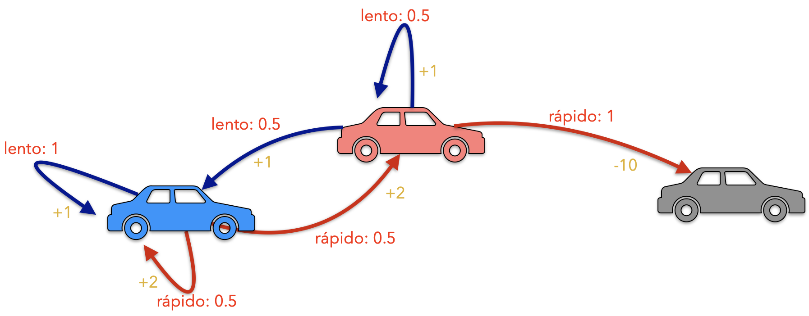
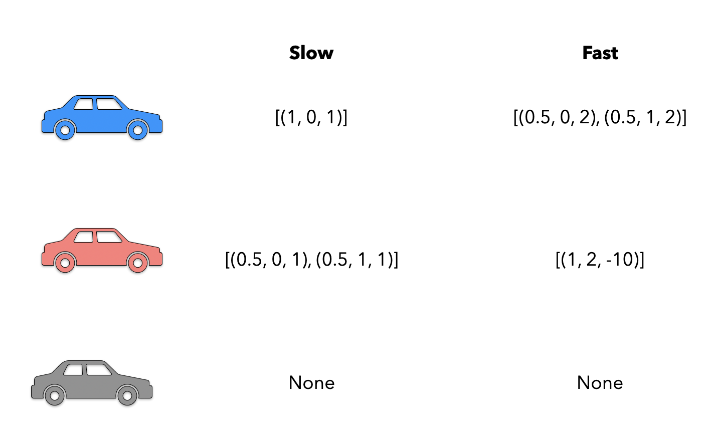

::: {.callout-note}
## Actividad calificable

Versión de lectura del [notebook original](originales/car.ipynb), conservado sin cambios. El código se muestra sin ejecutarse al renderizar el libro. Las imágenes se toman de `originales/`.

Se mantienen los enunciados, el código incompleto y los metadatos de las celdas de código. La conversión a Quarto no conserva todos los metadatos de calificación del notebook; confirma el formato de entrega en la plataforma.
:::


Para el taller de MDPs, vamos a construir el caso sencillo de un del ambiente de los estados del motor de un vehículo, como se muestra en la siguiente figura.



El ambiente contiene tres estados en los que se puede encontrar un vehículo en movimiento, frio (`cold` en azul), caliente (`hot` en rojo), o recalentado (`overheated` en gris). El vehículo tiene dos acciones posibles, ir rápido (`fast`) o ir lento (`slow`), las cuales se muestran como una etiqueta roja sobre las transiciones entre los estados. Asociado a cada una de las transiciones, también encontramos la recompensa asociada de ejecutar la acción.

El trabajo de este taller consiste en construir un MDP que modele el ambiente mostrado en la figura

#### 1. Estructura del ambiente

Para definir el ambiente requerido utilizaremos una clase `MDP`. Esta clase recibe como parámetro una codificación de los estados, la dimensión del MDP dada por la cantidad de estados en el ambiente (dados como una tupla) y el estado inicial.

La codificación del ambiente se puede realizar de varias formas. Por facilidad de uso más adelante en la ejecución de las funciones del ambiente, en este caso lo definiremos como una tabla de tamaño `estados x acciones` que para cada uno de los estados (filas) contiene una lista de tuplas con la información de la probabilidad asociada a la acción de la columna, el estado de llegada de ejecutar la acción y la recompensa asociada a la ejecución de la acción. La codificación de la tabla se muestra a continuación. Note que como una precondición, la definición de los estados debe ser correcta, enumerándolos como `cold=0`, `warm=1` y `overheated=2`.



Las dimensiones del tablero se almacenan en los astributos `nrows` y `ncols` de la clase `MDP`.
Los valores codificados en el tablero se almacenarán en dos atributos de la clase, un atributo `transitions` que mantiene la probabilidad de transición de un estado a otro dada una acción como una lista de tuplas `(probability, state)` y un atributo `rewards` que mantiene la información las recompensas obtenida en el paso entre estados definido como una lista `(reward, state)`.

Adicionalmente la clase debe tener los atributos `initial_state` y `state` que corresponden al estado inicial, dado por parámetro, y el estado actual del agente en el ambiente, inicializado en el estado inicial.

Note también que el estado `overheated` no tienen ninguna acción asociada a él y por lo tanto lo consideramos como un estado final.

```{python}
#| deletable: false
#| nbgrader: {cell_type: code, checksum: d26e82160132f4ceac93fcabcc2c0b14, grade: false, grade_id: cell-22200347aa420047, locked: false, schema_version: 3, solution: true, task: false}
#Definición del ambiente de motores

#Librerias requeridas
# your code here
raise NotImplementedError

#Definición de la clase principal
class MDP:
    def __init__(self, table : list[list[tuple]], dimensions:tuple[int, int], initial_state:int):
        # your code here
        raise NotImplementedError

    def get_current_state(self) -> int:
        # your code here
        raise NotImplementedError

    def get_possible_actions(self, state:int) -> list[str]:
        # your code here
        raise NotImplementedError

    def do_action(self, action:str) -> tuple[float,int]:
        # your code here
        raise NotImplementedError

    def reset(self):
        # your code here
        raise NotImplementedError

    def is_terminal(self) -> bool:
        # your code here
        raise NotImplementedError


```

```{python}
#| deletable: false
#| editable: false
#| nbgrader: {cell_type: code, checksum: 62bda5689aa3bfb5e1bca9932d2acf4d, grade: true, grade_id: cell-8018062f76c7fb03, locked: true, points: 6, schema_version: 3, solution: false, task: false}
#Pruebas estructura del ambiente

table = [[[(1,0,1)], [(0.5, 0, 2), (0.5,1,2)]],
         [[(0.5, 0, 1), (0.5,1,1)], [(1, 2, -10)]],
         [None, None]]

env = MDP(table, (3,2), 0)

try:
    env.nrows
except:
    print("El atributo nrows no está definido")
try:
    env.ncols
except:
    print("El atributo ncols no está definido")
try:
    env.initial_state
except:
    print("El atributo initial_state no está definido")
try:
    env.state
except:
    print("El atributo state no está definido")
```

```{python}
#Pruebas adicionales
```

#### 2. Acciones del agente

Defina la función `do_action` que ejecuta la acción tomada por el agente dentro del ambiente. Esta función recibe como parámetro la acción a ejecutar (el nombre de la acción a ejecutar dentro de las acciones posibles del agente) y retorna (una tupla con) el valor la recompensa del estado de llegada de la acción y el estado de llegada.

Las acciones posibles del agente son `slow` y `fast` siguiendo la función de ruido dada por el MDP.

```{python}
#| deletable: false
#| editable: false
#| nbgrader: {cell_type: code, checksum: e9d9754d3f0d8d88cb43eed7b28b6ab4, grade: true, grade_id: cell-9aad4d2ec90a470d, locked: true, points: 6, schema_version: 3, solution: false, task: false}
#Pruebas de ejecución de las acciones

table = [[[(1,0,1)], [(0.5, 0, 2), (0.5,1,2)]],
         [[(0.5, 0, 1), (0.5,1,1)], [(1, 2, -10)]],
         [None, None]]

env = MDP(table, (3,2), 0)

try:
    env.do_action
except:
    print("La función do_action no está definida")
```

```{python}
#Pruebas adicionales
```

#### 3. Estado actual

Defina la función `get_current_state` que retorna el estado actual del agente. Esta función no recibe ningún parámetro y retorna el estado actual.

```{python}
#| deletable: false
#| editable: false
#| nbgrader: {cell_type: code, checksum: 014a799ab434cdb8790698da26ca7939, grade: true, grade_id: cell-8c920f38c1368623, locked: true, points: 3, schema_version: 3, solution: false, task: false}
#Pruebas estado actual

table = [[[(1,0,1)], [(0.5, 0, 2), (0.5,1,2)]],
         [[(0.5, 0, 1), (0.5,1,1)], [(1, 2, -10)]],
         [None, None]]

env = MDP(table, (3,2), 0)

try:
    env.get_current_state
except:
    print("La función do_action no está definida")
```

```{python}
#Pruebas adicionales
```

#### 4. Obtener las acciones

Defina la función `get_possible_actions` que recibe el estado actual del agente por parámetro y retorna una lista de las acciones válidas para el estado dado.

```{python}
#| deletable: false
#| editable: false
#| nbgrader: {cell_type: code, checksum: 86a3a35ef75dfd9e8181e0ef19984f55, grade: true, grade_id: cell-bdd0d062b8f1859b, locked: true, points: 4, schema_version: 3, solution: false, task: false}
#Pruebas de acciones posibles

table = [[[(1,0,1)], [(0.5, 0, 2), (0.5,1,2)]],
         [[(0.5, 0, 1), (0.5,1,1)], [(1, 2, -10)]],
         [None, None]]

env = MDP(table, (3,2), 0)

try:
    env.get_possible_actions
except:
    print("La función get_possible_actions no está definida")

```

```{python}
#Pruebas adicionales
```

#### 5. Reinicializar el ambiente

Defina la función `reset` que no recibe parámetros ni retorna ningún valor. El efecto de esta función es restablecer el ambiente a su estado inicial.

```{python}
#| deletable: false
#| editable: false
#| nbgrader: {cell_type: code, checksum: ae0bb942f76bf0a95e371ee9d6a84dea, grade: true, grade_id: cell-232dc31e9084322a, locked: true, points: 1, schema_version: 3, solution: false, task: false}
#Pruebas de reset

table = [[[(1,0,1)], [(0.5, 0, 2), (0.5,1,2)]],
         [[(0.5, 0, 1), (0.5,1,1)], [(1, 2, -10)]],
         [None, None]]

env = MDP(table, (3,2), 0)

try:
    env.reset
except:
    print("La función reset no está definida")
```

```{python}
#Pruebas adicionales
```

#### 6. Estados terminales

Defina la función `is_terminal` que determina si el agente está en un estado final o no. En nuestro caso los estados finales o los estados de salida estarán determinados por las casillas con recompensa 1 o -1.
Esta función no recibe parámetros y retorna un booleano determinando si el agente está en un estado final o no.

```{python}
#| deletable: false
#| editable: false
#| nbgrader: {cell_type: code, checksum: 0922d7b5c63cd983eafb611fdc7aeaf2, grade: true, grade_id: cell-fcfdfbaeb99290c1, locked: true, points: 3, schema_version: 3, solution: false, task: false}
#Pruebas terminación

table = [[[(1,0,1)], [(0.5, 0, 2), (0.5,1,2)]],
         [[(0.5, 0, 1), (0.5,1,1)], [(1, 2, -10)]],
         [None, None]]

env = MDP(table, (3,2), 0)

try:
    env.is_terminal
except:
    print("La función is_terminal no está definida")
```

```{python}
#Pruebas adicionales
```

#### Ejecución

Ahora vamos a ejecutar nuestro MDP.

Para la ejecución del MDP vamos a ejecutar las todas las acciones hasta encontrar el estado terminal, observando los estados por los que pasa el agente y la recompensa asociada acumulada de toda la ejecución.

```{python}
#| deletable: false
#| editable: false
#| nbgrader: {cell_type: code, checksum: ce0cdcdd214ac3a31afe8f7159fc49cc, grade: true, grade_id: cell-e0742ccaef8993dd, locked: true, points: 1, schema_version: 3, solution: false, task: false}
import random

table = [[[(1,0,1)], [(0.5, 0, 2), (0.5,1,2)]],
         [[(0.5, 0, 1), (0.5,1,1)], [(1, 2, -10)]],
         [None, None]]

env = MDP(table, (3,2), 0)

done = False
total_reward = 0
steps = 0
while not done:
    old_state = env.get_current_state()
    action = random.choice(env.get_possible_actions(old_state))
    reward, new_state = env.do_action(action)
    total_reward += reward
    print(f"Ejecutando la acción {action} desde el estado {old_state} al estado {new_state}")
    steps += 1
    done = env.is_terminal()
print(f"Ejecuto {steps} pasos y obtuvo una recompensa de {total_reward}")
```

## Preguntas de reflexión

¿Qué puede concluir de la ejecución del MDP en cuanto a la cantidad de acciones que se ejejcutan? ¿Existe alguna diferencia?
